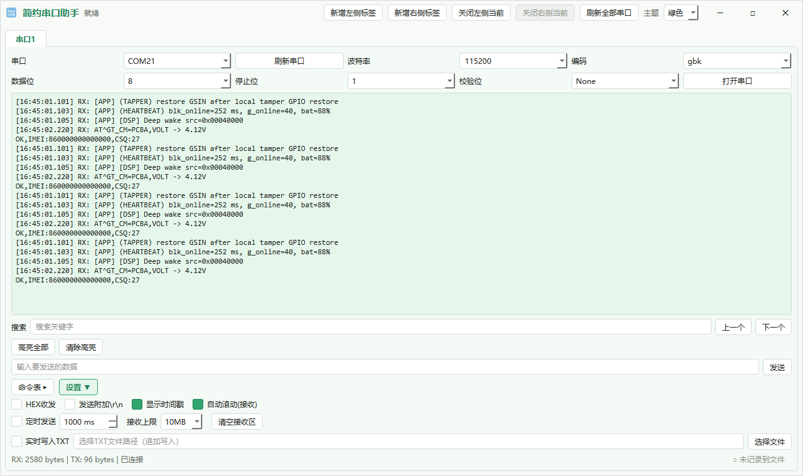
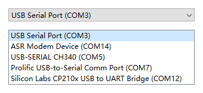
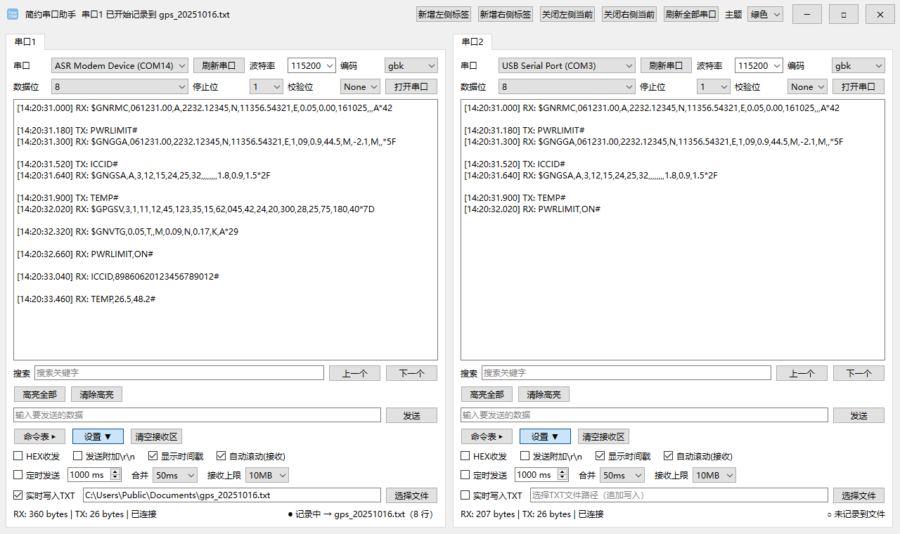
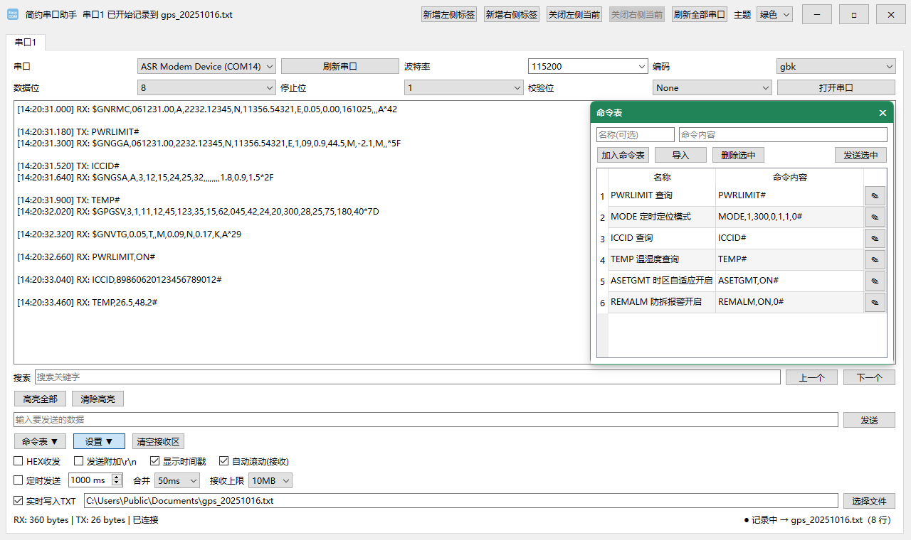
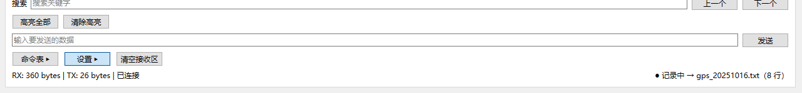
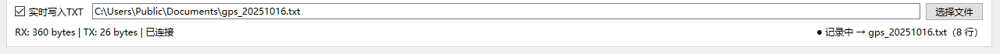
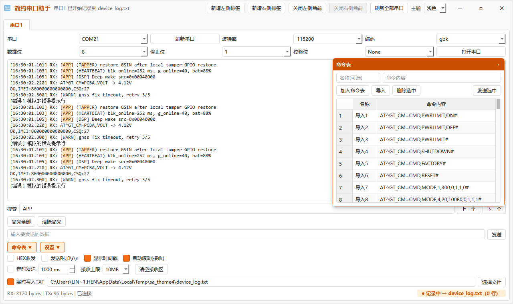
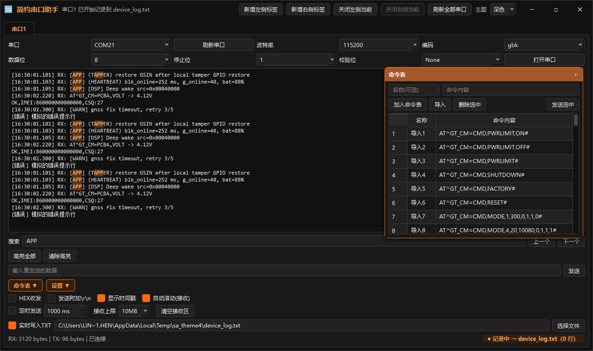

# 简约串口助手 v3.0.1

一个面向 Windows 的串口调试工具，用 `PySide6` + `pyserial` 写成**单个 `main.py`**：
多标签、左右分屏、HEX 收发、时间戳、关键字检索与高亮、悬浮命令表，
内置**浅色 / 深色 / 绿色**三套主题（默认绿色）。

**端口下拉框直接显示设备管理器里的名字**——`USB Serial Port (COM3)`、
`ASR Modem Device (COM14)`，而不是光秃秃的 `COM3`：同时插着几个 USB 转串口时，
一眼就能分清哪个是哪个。



## 功能特性

**串口与收发**

- 串口参数：端口、波特率（预设 1200–921600，可手输）、数据位 5–8、停止位 1/1.5/2、校验位 None/Odd/Even
- 端口名取设备管理器的友好名；鼠标悬停可看完整名字与硬件 ID（`USB VID:PID=…`）
- 文本 / HEX 收发模式，发送可自动附加 `\r\n`
- 中文编码支持 `gbk` / `gb18030` / `utf-8`
- 定时发送（10–60000 ms，运行中可即时调整间隔）
- 「清空接收区」就放在工具栏「设置」右边，设置收起来时也能直接点

**显示与检索**

- 接收 / 发送时间戳（毫秒），默认开启
- **接收合并**：空闲超时才输出一条（关闭 / 30 / 50 / 100 / 200 ms，默认 50 ms）。
  串口是字节流渐进到达的，一条长报文会被读线程切成好几批，逐批显示就会在报文
  中间插进时间戳和 `RX` 前缀；缓冲满 4 KB 强制输出，避免连续不断的流把延迟拉长
- 接收上限可选 512 KB / 1 MB / 10 MB / 40 MB（默认 10 MB），超限自动裁剪前段
- 关键字搜索（上一个 / 下一个）、高亮全部、清除高亮
- 自动滚动（可关）、实时追加写入 TXT，并有「记录中 → xxx.txt（N 行）」常驻指示

**多标签与命令表**

- 可开多个标签页，支持左右并排分屏；单标签时自动占满
- 悬浮命令表：可拖动，**双击整行即发送**，行尾 `✎` 图标进入编辑（按 Tab 接着改内容），
  支持加入 / 导入 / 删除 / 发送选中，可导入 `.txt` / `.json` 指令文件

**界面与主题**

- 浅色 / 深色 / 绿色一键切换，选择会记住，下次启动自动恢复
- 无边框窗口：工具栏合并进标题栏，支持拖动、双击最大化、边缘缩放

## 界面速览

**端口下拉：设备管理器友好名**



**左右分屏：两个串口各占一半**



**悬浮命令表：点两下就把指令发出去**



**设置收起后仍可用的工具栏，与底部状态**





**标题栏即工具栏（无边框窗口）**

| 浅色 | 深色 |
| --- | --- |
|  |  |

## 主题

标题栏右侧「主题」下拉框可随时切换，切换后所有已打开的标签页立即重绘，
选择写入 `~/.serial_assistant/config.json`，下次启动恢复。**默认绿色。**

| 浅色 | 深色 |
| --- | --- |
|  |  |

三套主题的色值全部对齐 [Radix Colors](https://www.radix-ui.com/colors) 色阶，
代码里每个值都标注了对应色阶编号（如 `# green-2`），微调时按编号定位。
色阶语义：`1` 应用背景 / `2` 次级背景 / `3` 控件背景 / `4` hover / `5` active /
`6` 边框 / `9` 实心主色 / `11` 低对比文字 / `12` 高对比文字。

主题由「调色板 + 全局样式表」两层构成（见 `main.py` 中的 `Theme` /
`build_palette` / `build_qss`），新增配色只需在 `THEME_LIST` 里加一个
`Theme` 实例。

两个容易踩的点：

- `accent` 与 `accent_text` 必须分开取值。前者用于实心填充，后者用于文字，
  深色模式下两者的合适亮度并不相同，共用一个值会导致文字对比度不足。
- `QCheckBox::indicator` 的样式里不要使用 `data:` URI 的 SVG 图标，Qt 的
  样式表解析器会因此报错并**丢弃整张样式表**，勾选态用实心色块表达。

## 项目结构

- `main.py`：主程序（单文件，含主题系统、串口线程、自定义标题栏、界面）
- `requirements.txt`：Python 依赖
- `assets/app.ico`：程序图标
- `screenshots/`：主题与界面效果截图（用脚本重新生成，见下）
- `SerialAssistant_v3.spec`：v3 系列的单文件打包配置（其余 `SerialAssistant*.spec` 为历史版本配置）
- `build_gps_commands.py`、`gps_tracker_commands*`：GPS 指令集与生成脚本
- `.gitignore`：Git 忽略规则

## 用户数据

| 路径 | 内容 |
| --- | --- |
| `~/.serial_assistant/config.json` | 主题等偏好设置 |
| `~/.serial_assistant/commands.json` | 命令表内容 |

> 旧版本的 `~/.serial_assistant_commands.json` 会在首次启动时自动迁移。

## 运行

Windows 下双击桌面快捷方式「简约串口助手」即可启动（快捷方式指向
`pythonw.exe` + `main.py`，不会弹出控制台窗口）。

也可以命令行运行：

```bash
pip install -r requirements.txt
python main.py
```

开发时用 `.venv/`（列在 `.gitignore` 里，不会随仓库分发）：

```bat
.venv\Scripts\python.exe main.py
```

## 打包（onefile）

用 `SerialAssistant_v3.spec`，产物为单文件、无控制台，并关闭了 UPX 压缩
（压缩会明显提高杀软误报率，分享给他人时得不偿失）：

```bash
pyinstaller --noconfirm --clean SerialAssistant_v3.spec
```

打包产物：`dist\SerialAssistant.exe`。

## 环境信息

| 组件 | 版本 |
| --- | --- |
| Python | 3.9 及以上（在 3.10.8 上验证） |
| PySide6 | 6.9.1 |
| pyserial | 3.5 |
| PyInstaller | 6.x（在 6.22.3 上验证） |

界面用 `ctypes.wintypes` 实现无边框窗口的拖动与边缘缩放，非 Windows 平台
会跳过这部分，其余功能不受影响。

## 开发期工具

`.venv/easycom-verify/` 下另有一组开发期脚本（不随仓库分发），覆盖功能回归、
界面抓图与打包产物冒烟测试，README 里的截图即由其中的 `make_screenshots.py`
生成（真实 Windows 平台渲染，窗口不会弹出来）。
